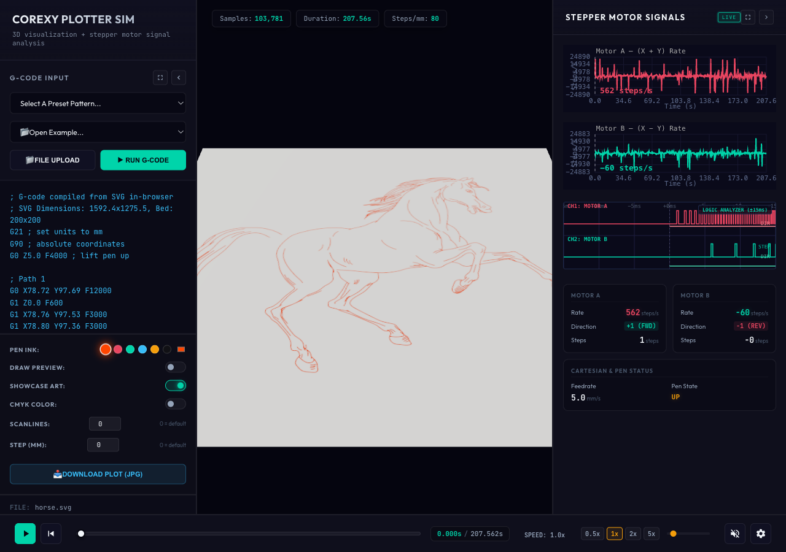

# CoreXY Plotter Simulator

An in-browser, real-time **3D simulation of a CoreXY 2D plotter**. Load G-code, SVG line art, or raster images — then watch the pen draw on a virtual paper bed while a digital logic analyzer shows live STEP/DIR stepper signals and a synthesizer plays the motor sounds.

[](https://vercel.com/new/clone?repository-url=https%3A%2F%2Fgithub.com%2Fbetterthanyou155%2Fmcp-2d-plotter)



## Features

- **Real CoreXY kinematics** — dual stepper motors driven through the exact `A = X + Y`, `B = X − Y` transform, with trapezoidal velocity planning (accel / cruise / decel).
- **Three input paths** — paste or upload **G-code**, drop in **SVG line art** (lexical parser tessellates Bézier curves), or compile **JPEG/PNG images** into halftone G-code.
- **Image halftone compiler** — brightness-modulated wavy scanlines (AM/FM), plus a **CMYK mode** with classic 15°/75°/0°/45° screen angles and subtractive ink mixing. Compilation runs in a Web Worker so the UI never freezes.
- **Perfectly synced output** — the 3D view, motor graphs, and audio all read from one precomputed "tape" array at the same time index, so scrubbing stays frame-accurate everywhere.
- **Stepper signal analysis** — live step-rate graphs and a ±15 ms STEP/DIR logic analyzer with motor direction and step counters.
- **Synthesized motor audio** — Web Audio oscillators whose frequency tracks each motor's instantaneous step rate (mutable).
- **Download your plot** — export the finished artwork as a high-resolution JPG with real subtractive ink blending.
- **Performance first** — no React re-renders at 60 fps (continuous state lives in refs), incremental canvas drawing, zero-allocation render loops, code splitting for fast first load.

## Tech Stack

React 19 · TypeScript · Vite 8 · react-three-fiber · Three.js · Web Audio API · Web Workers

## Getting Started

```bash
npm install
npm run dev        # start the dev server at http://localhost:5173
```

Production build:

```bash
npm run build      # type-check + bundle (output in dist/)
npm run preview    # serve the production build locally
npm run lint       # oxlint
```

## How to Use

1. **Pick a start**: choose a preset pattern (spiral, grid, star), the bundled sample file, or an example SVG from the dropdowns in the left panel.
2. **Or bring your own**: paste G-code, or upload `.gcode`, `.svg`, `.png`, `.jpg` files.
3. **Play**: hit **Start Simulation** — the pen draws, the graphs trace step rates, and the audio follows the motors. Use the scrubber to jump anywhere in the job; everything stays in sync.
4. **Tune it**: adjust steps/mm, acceleration, feedrate, and bed size in the settings drawer. Choose ink color, toggle CMYK for images, or switch on *Showcase Art* for a gallery-style view of the finished drawing.

## How It Works

1. **Parse** — G-code / SVG / images are converted into a list of moves (`start`, `end`, `feedrate`, `penDown`).
2. **Plan** — each move gets a trapezoidal velocity profile (acceleration, cruise, deceleration).
3. **Bake** — the profile is sampled into a flat "tape" array (`TapeSample` at every 2 ms: position, pen state, motor step positions/rates, direction).
4. **Play** — the 3D scene, motor graphs, and synthesizer all advance through the same tape at the same clock tick — perfect sync with zero coordination.

```
G-code / SVG / Image  →  Move[]  →  SegmentProfile[]  →  TapeSample[]  →  3D scene + graphs + audio
```

CoreXY kinematics:

```
A = X + Y          (motor A steps)
B = X − Y          (motor B steps)

Both motors same direction  →  X movement
Motors opposite direction   →  Y movement
```

## Project Structure

```
src/
├── sim/        # Simulation engine: parsers, motion planner, tape baker, kinematics
├── clock/      # Simulation clock + Web Audio stepper synthesizer
├── scene/      # 3D visualization (react-three-fiber): frame, pen carriage, paper
├── motor/      # Step-rate graphs, logic analyzer, digital readouts
├── components/ # UI: G-code input, playback controls, settings panel
└── App.tsx     # Dashboard integration
public/
├── image-compiler.worker.js   # Off-main-thread halftone image → G-code
├── examples/                  # Sample SVG line art
└── sample.gcode               # Bundled sample job
```

## Deploy

This is a fully static Vite app — one click on the button above deploys it to Vercel (it auto-detects the Vite framework). Any static host works: `npm run build` produces a ready-to-serve `dist/`.

## License

[MIT](LICENSE)
